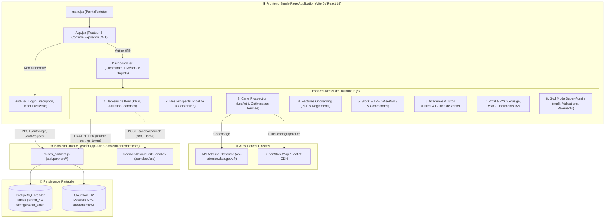

# 🏛️ Architecture Technique — STACK Partners Frontend

> **Document de référence architectural**  
> *Dernière mise à jour : 07/11/2026*  
> *Dépôt GitHub : `https://github.com/valentin-td/stack-partners-frontend.git`*  
> *Dossier local : `/Users/valentinsamba/stack-partners-frontend` (branche `main`)*  
> *Écosystème global : Voir également la documentation de l'écosystème dans `APP-GITHUB/docs/STACK_ECOSYSTEM.md`*

---

## 1. Vue d'Ensemble & Mission

**STACK Partners Frontend** est l'application web dédiée exclusivement au réseau d'agents commerciaux indépendants et apporteurs d'affaires de la solution STACK. Elle a pour vocation :
1. **La prospection terrain assistée par cartographie** : géocodage des salons de coiffure et barbiers cibles, suivi des visites et calcul d'itinéraires de tournée optimisés.
2. **La démonstration en direct (Sandbox SSO)** : génération instantanée d'un salon de démonstration live et ouverture en un clic dans STACK Pro sans pop-up légal bloquant.
3. **Le pilotage du pipeline commercial** : gestion des prospects du premier contact jusqu'à la signature et l'onboarding.
4. **La gestion du matériel TPE** : suivi du stock physique de terminaux Stripe BBPOS WisePad™ 3 attribués à l'agent.
5. **La facturation et le versement des commissions** : calcul automatisé des primes d'onboarding et récurrentes, génération des factures PDF et suivi des virements.
6. **La conformité légale agent (KYC)** : inscription au Registre Spécial des Agents Commerciaux (RSAC), signature électronique du mandat commercial via Yousign et stockage sécurisé des pièces d'identité sur Cloudflare R2.
7. **La supervision centrale (God Mode)** : tableau de bord super-administrateur permettant d'auditer les agents, de valider leurs pièces justificatives et de libérer les paiements de commissions.

---

## 2. Diagramme Architectural Global



---

## 3. Structure des Fichiers et Rôles

```
stack-partners-frontend/
├── index.html                   # Point d'ancrage HTML5
├── package.json                 # Dépendances (React 18, React Router DOM 6, Vite 5)
├── vite.config.js               # Configuration du bundler Vite
├── .env                         # VITE_API_URL pointant vers api-salon-backend.onrender.com
├── public/                      # Assets statiques et logos
├── docs/                        # Référentiel documentaire architectural
│   ├── ARCHITECTURE.md          # Le présent document
│   ├── FEATURES.md              # Inventaire fonctionnel exhaustif
│   ├── API_CONTRACTS.md         # Spécifications de tous les endpoints consommés
│   ├── DATA_FLOWS.md            # Diagrammes de flux de données
│   ├── DEPENDENCIES.md          # Analyse des dépendances et couplages
│   └── IMPACT_ANALYSIS.md       # Matrice d'impact des modifications
└── src/
    ├── main.jsx                 # Montage React DOM
    ├── App.jsx                  # Routage déclaratif et vérification de validité JWT
    ├── Auth.jsx                 # Formulaires d'authentification, onboarding et reset password
    └── Dashboard.jsx            # Composant central intégrant les 8 onglets métier
```

---

## 4. Cycle de Vie des Sessions et Sécurité JWT

1. **Jeton d'accès (`partner_token`)** :
   - Délivré par le backend lors du `POST /api/partners/auth/login`.
   - Contient l'identifiant de l'agent (`id_agent`), son email et son rôle (`role: 'partner'`).
   - Stocké dans le `localStorage` du navigateur.
2. **Détection d'expiration proactive (`App.jsx`)** :
   - À chaque transition de route, `isTokenExpired()` décode le payload Base64 du JWT.
   - Si `decoded.exp * 1000 <= Date.now()`, le token et les données mises en cache sont immédiatement purgés et l'utilisateur est redirigé vers `/login`.
3. **Capture d'expiration réactive (401)** :
   - Toute requête fetch renvoyant un code HTTP 401 ou `{ session_expiree: true }` déclenche le nettoyage du `localStorage` et la redirection vers `/login`.
