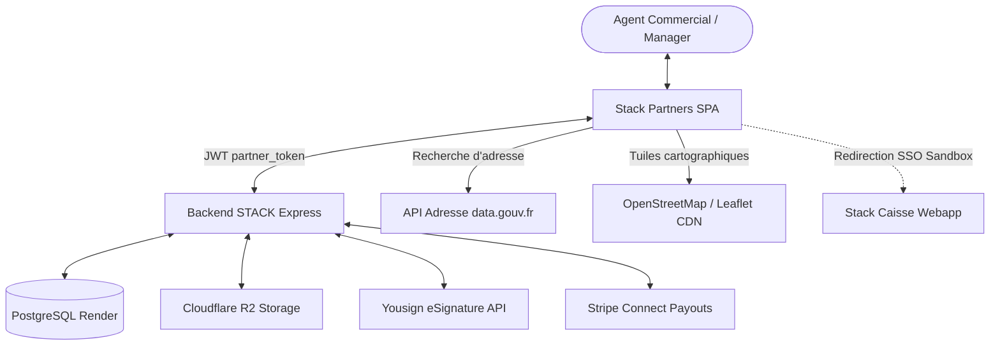
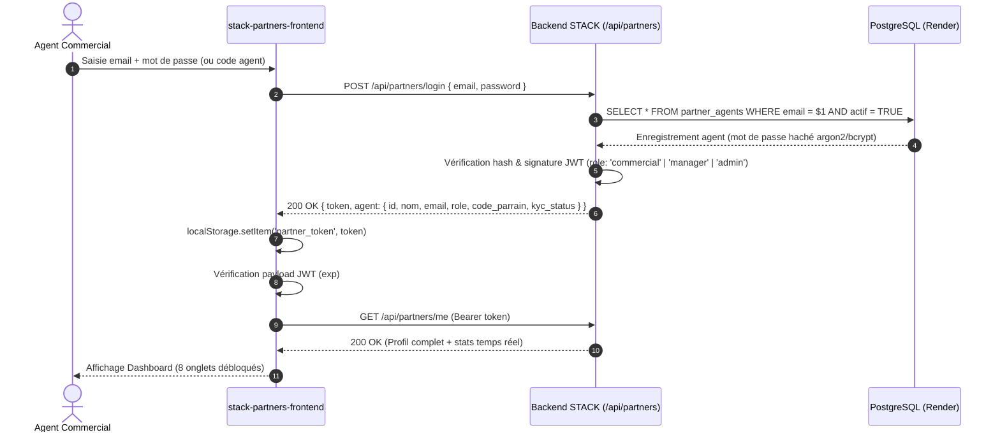
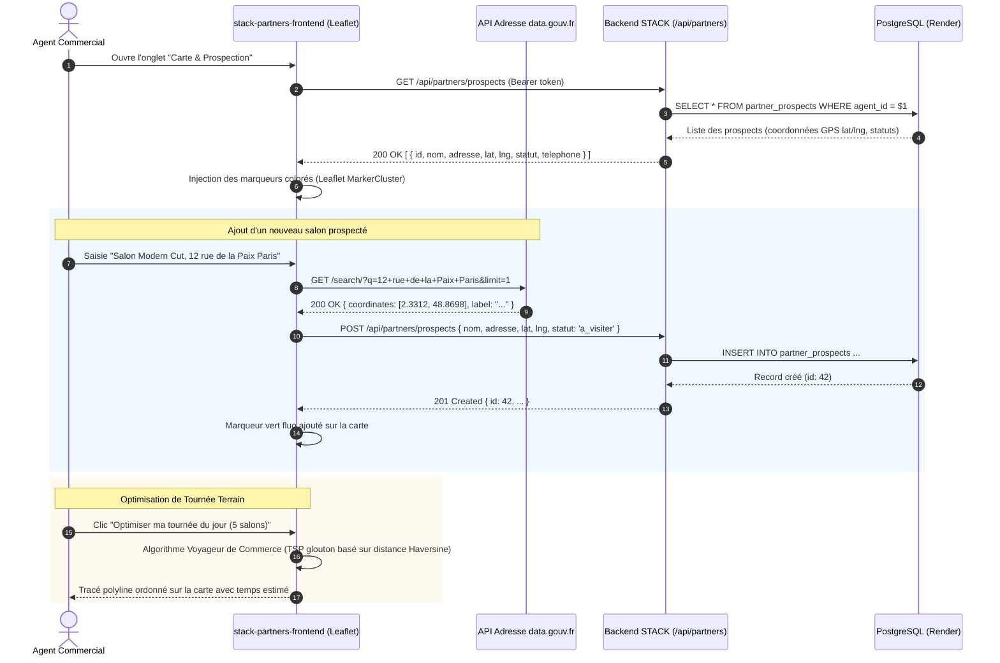
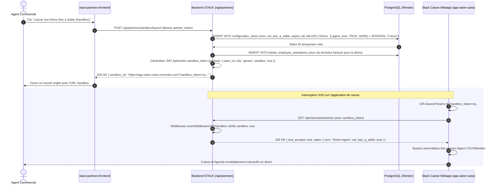
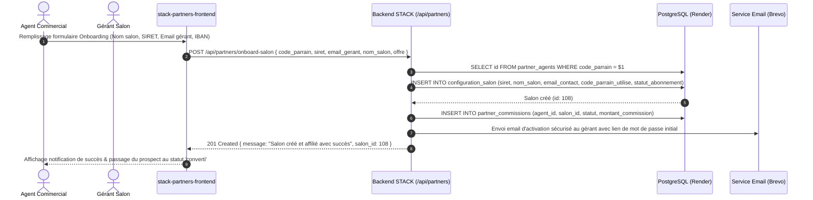
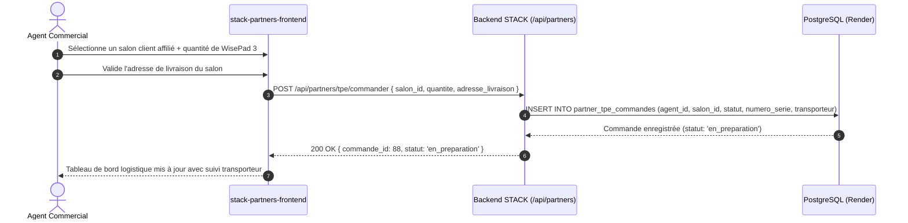
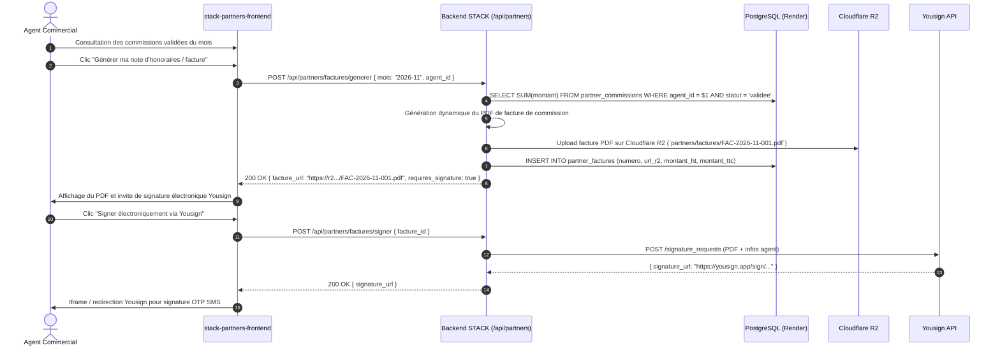

# 🔄 Flux de Données et Séquences Métier — Stack Partners

> **Cartographie exhaustive des échanges de données, protocoles et flux d'état de l'application partenaires.**  
> *Dernière mise à jour : 07/11/2026*  
> *Application : `stack-partners-frontend` (Portail Agents Commerciaux)*

---

## 1. Vue d'Ensemble des Flux

L'application `stack-partners-frontend` est une Single Page Application (SPA) React qui orchestre ses échanges autour de :
1. **L'API Backend Unifiée STACK** (`https://api-salon-backend.onrender.com/api/partners/*`) hébergée dans le repository `APP-GITHUB`.
2. **L'API Adresse du Gouvernement Français** (`https://api-adresse.data.gouv.fr/search/`) pour le géocodage haute précision des prospects en direct.
3. **Le service de cartographie Leaflet / OpenStreetMap** (CDN `unpkg.com`) pour le rendu des cartes de prospection et tournées.
4. **La passerelle SSO Sandbox** reliant instantanément un agent commercial à l'application de caisse STACK en production (`https://app-salon-caiss.onrender.com/?sandbox_token=...`).

---

## 2. Flux 1 : Authentification & Contrôle d'Accès de l'Agent

L'authentification s'appuie sur une session JWT dédiée (`partner_token`) stockée dans le `localStorage`. La SPA vérifie systématiquement son expiration avant tout affichage.

---

## 3. Flux 2 : Prospection Cartographique, Géocodage & Tournées

L'agent consulte la carte interactive des salons prospectés, géocode de nouveaux prospects via l'API publique `data.gouv.fr`, et calcule son itinéraire optimisé de visite.

---

## 4. Flux 3 : Démonstration en Direct via la Passerelle SSO Sandbox

L'une des innovations majeures de l'écosystème Stack est la capacité pour l'agent commercial de lancer en 1 clic une démonstration fonctionnelle de l'application de caisse devant le gérant sans passer par un formulaire d'inscription fastidieux.

---

## 5. Flux 4 : Onboarding Salon & Affiliation Partenaire

Dès que le prospect est convaincu, l'agent commercial l'onboarde directement depuis son interface Stack Partners.

---

## 6. Flux 5 : Logistique Matériel — Commande de TPE WisePad 3

L'agent commercial peut commander et assigner des terminaux de paiement physiques Stripe WisePad 3 pour les salons qu'il a parrainés.

---

## 7. Flux 6 : Facturation des Commissions, Signature Yousign & Cloudflare R2

Les commissions récurrentes dues aux agents commerciaux font l'objet d'un flux financier et contractuel rigoureux.

