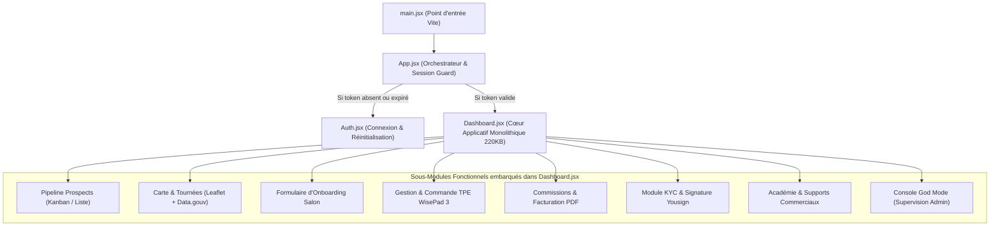

# 🕸️ Cartographie des Dépendances — Stack Partners

> **Analyse structurelle des dépendances internes, bibliothèques externes et couplages écosystème**  
> *Dernière mise à jour : 07/11/2026*  
> *Application : `stack-partners-frontend` (Portail Agents Commerciaux)*

---

## 1. Dépendances Logicielles (package.json)

L'application est délibérément légère et construite sur une stack moderne et épurée :

| Package | Version | Type | Rôle / Utilisation |
| :--- | :--- | :--- | :--- |
| `react` | `^18.2.0` | Production | Moteur de rendu déclaratif de l'interface utilisateur. |
| `react-dom` | `^18.2.0` | Production | Intégration DOM React pour environnement web. |
| `react-router-dom` | `^6.22.0` | Production | Routage SPA client (support des routes directes et paramètres d'URL). |
| `vite` | `^5.1.4` | Développement | Bundler moderne, serveur de développement HMR ultra-rapide et build Rollup. |
| `@vitejs/plugin-react` | `^4.2.1` | Développement | Plugin officiel Fast Refresh et compilation JSX via Babel/SWC. |

---

## 2. Dépendances Externes & Services Tiers

L'application s'appuie sur plusieurs services cloud et API distantes :

```mermaid
flowchart LR
    subgraph SPA [stack-partners-frontend]
        Auth["Auth.jsx"]
        Dash["Dashboard.jsx"]
    end

    subgraph BackendSTACK [Backend STACK (APP-GITHUB)]
        API["API Express /api/partners/*"]
        DB[(PostgreSQL Render)]
        R2["Cloudflare R2 (Factures/KYC)"]
        Yousign["Yousign eSignature"]
    end

    subgraph ExternalWeb [Services Web Externes]
        DataGouv["API data.gouv.fr (Adresses)"]
        OSM["OpenStreetMap / Leaflet (Carto)"]
        CaisseApp["Webapp Caisse (Sandbox SSO)"]
    end

    Auth -->|POST /login| API
    Dash -->|CRUD Prospects, Factures, KYC| API
    Dash -->|Géocodage adresse| DataGouv
    Dash -->|Rendu cartes & clusters| OSM
    Dash -.->|Redirection ?sandbox_token| CaisseApp
    API --> DB
    API --> R2
    API --> Yousign
```

### A. Backend STACK Unifié (Render)
- **URL de Base** : `https://api-salon-backend.onrender.com/api/partners`
- **Couplage** : Très fort. Toutes les données métier (prospects, agents, statistiques, commissions, stocks TPE, formations académie) proviennent de cette API.
- **Protocole** : HTTP REST / JSON avec en-tête `Authorization: Bearer <partner_token>`.

### B. API Adresse du Gouvernement Français (data.gouv.fr)
- **URL** : `https://api-adresse.data.gouv.fr/search/`
- **Rôle** : Autocomplétion et géocodage instantané (latitude, longitude, code postal, ville) lors de l'enregistrement d'un salon prospecté par l'agent.
- **Résilience** : Service public sans authentification préalable, fallback direct si indisponible.

### C. Moteur Cartographique Leaflet
- **Rôle** : Rendu cartographique vectoriel et raster des prospects géolocalisés, calcul des distances et affichage des tournées.
- **Fournisseur de Tuiles** : OpenStreetMap (`https://{s}.tile.openstreetmap.org/{z}/{x}/{y}.png`).

### D. Cloudflare R2 Object Storage
- **Rôle** : Hébergement sécurisé des documents légaux KYC (Kbis, CNI, attestation RSAC, RIB) et des factures de commissions générées.
- **Accès** : Téléchargement direct via URL pré-signées ou publiques distribuées par le backend.

### E. Yousign eSignature API
- **Rôle** : Signature électronique juridiquement probante (eIDAS) des mandats de commercialisation et des notes d'honoraires mensuelles.

---

## 3. Dépendances Structurelles Internes du Code Source

L'architecture interne repose sur une hiérarchie épurée de 4 fichiers principaux :



---

## 4. Analyse des Risques et Zones de Fragilité

1. **Monolithe Frontend (`Dashboard.jsx` de 220 KB)** :
   - *Constat* : `Dashboard.jsx` regroupe l'ensemble des 8 onglets opérationnels, leurs états locaux, et les appels fetch associés.
   - *Risque* : Maintenance délicate et re-renders fréquents lors des mises à jour d'état profondes.
   - *Recommandation future* : Découper progressivement en composants enfants isolés (`components/dashboard/tabs/PipelineTab.jsx`, `MapTab.jsx`, etc.) comme réalisé avec succès sur le repo principal `APP-GITHUB`.

2. **Absence de Mock API pour les Tests** :
   - *Constat* : La SPA communique directement avec l'environnement Render sans couche intermédiaire d'abstraction ou mock.
   - *Risque* : En cas de coupure réseau ou de mise en veille du serveur gratuit Render, l'interface affiche des états de chargement bloqués.
   - *Atténuation* : Gestion gracieuse des erreurs réseau avec toasts d'alerte et bouton "Réessayer".

3. **Couplage SSO avec le Domaine Caisse** :
   - *Constat* : La fonction "Lancer Démo Sandbox" suppose l'existence de `https://app-salon-caiss.onrender.com/?sandbox_token=...`.
   - *Risque* : Si le nom de domaine de la caisse change ou si le middleware SSO du backend est altéré, les démonstrations terrain échouent.
   - *Garantie* : Test d'intégration et synchronisation de configuration assurés dans la cartographie globale `docs/STACK_ECOSYSTEM.md`.
