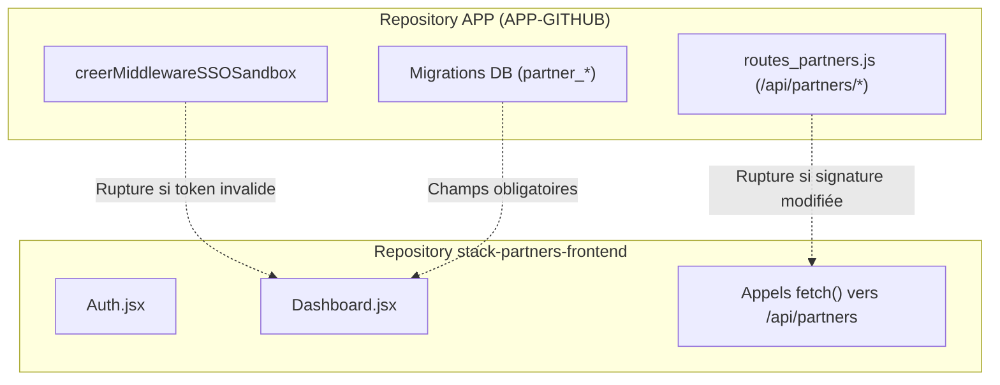

# 🛡️ Guide d'Impact et Analyse des Risques — Stack Partners

> **Matrice de sensibilité, règles d'intervention et protocole de non-régression**  
> *Dernière mise à jour : 07/11/2026*  
> *Application : `stack-partners-frontend` (Portail Agents Commerciaux)*

---

## 1. Principes Fondamentaux de Stabilité

L'application `stack-partners-frontend` est l'outil de travail direct des équipes commerciales sur le terrain (démonstrations en clientèle, signature de contrats, saisie d'onboarding salon). Toute indisponibilité ou régression bloque immédiatement le cycle de vente de STACK.

> [!IMPORTANT]
> **Règle d'Or d'Intervention** :
> Avant toute modification du code source dans `stack-partners-frontend` :
> 1. Vérifier la compatibilité des contrats d'API avec `APP-GITHUB/routes_partners.js`.
> 2. Vérifier que la compilation de production réussit sans erreur (`npm run build`).
> 3. Ne jamais casser la chaîne SSO Sandbox (`POST /api/partners/sandbox/launch`) qui permet les démos en clientèle.

---

## 2. Matrice d'Impact par Composant

| Composant / Fichier | Criticité | Risque en cas d'erreur | Mesures de Précaution / Protocole |
| :--- | :--- | :--- | :--- |
| **`src/Auth.jsx`** | 🔴 Élevée | Impossible pour les commerciaux de se connecter ou de restaurer leur session. Perte d'accès sur le terrain. | Valider le stockage local `localStorage.getItem('partner_token')`, vérifier le parsing JWT (exp) et tester le cas d'expiration sans boucle infinie. |
| **`src/App.jsx`** | 🔴 Élevée | Écran blanc total au démarrage de la SPA si le guard de session ou le montage de `Dashboard` échoue. | Tester les 3 états : token absent (affiche Auth), token expiré (redirige vers Auth avec message), token valide (monte Dashboard). |
| **`Dashboard.jsx` (Section Démo Sandbox)** | 🔴 Élevée | Échec de l'ouverture du salon de démonstration en direct devant un gérant de salon prospecté. | Tester la requête `POST /api/partners/sandbox/launch` et l'ouverture correcte de l'URL contenant `?sandbox_token=...`. |
| **`Dashboard.jsx` (Section Onboarding)** | 🔴 Élevée | Création incomplète d'un salon client dans la base PostgreSQL ou perte de l'affiliation commerciale (code parrain). | Vérifier la transmission obligatoire du `code_parrain` et des informations fiscales (SIRET, IBAN gérant). |
| **`Dashboard.jsx` (Section Factures & Commissions)** | 🟠 Modérée | Calcul erroné des rétrocessions ou échec de téléchargement des factures PDF / signature Yousign. | Vérifier la conformité des montants HT/TTC et la validité des URL de stockage Cloudflare R2 renvoyées. |
| **`Dashboard.jsx` (Carte & Prospection)** | 🟡 Faible | Les marqueurs ne s'affichent pas ou le géocodage `data.gouv.fr` échoue. | Prévoir un fallback en cas de coordonnées GPS manquantes ou de latence du service OpenStreetMap. |
| **`Dashboard.jsx` (Commande TPE)** | 🟠 Modérée | Commande de matériel WisePad 3 non transmise ou perte du numéro de suivi. | Vérifier le payload `{ salon_id, quantite, adresse_livraison }` et le feedback visuel immédiat pour l'agent. |

---

## 3. Matrice de Couplage Inter-Repositories

Toute modification apportée à l'un des deux dépôts peut impacter l'autre :

### Directives de Synchronisation :
1. **Ajout d'un champ dans une table partenaire** (ex: `partner_prospects`) :
   - Mettre à jour `routes_partners.js` dans `APP-GITHUB`.
   - Tester l'endpoint backend avec curl ou un test unitaire.
   - Intégrer ensuite le champ dans `Dashboard.jsx` dans `stack-partners-frontend`.
2. **Modification d'un statut d'onboarding ou de commission** :
   - Toujours conserver la rétrocompatibilité des enums de statuts (`en_attente`, `validee`, `rejetee`, `payee`).
3. **Mise à jour du système de démo Sandbox** :
   - Ne jamais modifier le format du paramètre d'URL `sandbox_token` sans synchroniser le middleware côté webapp de caisse.

---

## 4. Checklist Pré-Déploiement (Production Readiness)

Avant de pousser (`git push origin main`) sur `stack-partners-frontend` :

- [ ] **1. Compilation Vite** : Exécuter `npm run build` et s'assurer d'une sortie propre dans `dist/` sans avertissements de syntaxe.
- [ ] **2. Authentification** : Vérifier que la connexion avec identifiants valides et invalides produit le résultat attendu.
- [ ] **3. Navigation Onglets** : Vérifier qu'aucun onglet ne génère de crash React (`Uncaught TypeError`).
- [ ] **4. Clés et Jetons** : Vérifier qu'aucun secret (clé Stripe, token admin Yousign) n'est commité en dur côté client.
- [ ] **5. Console DevTools** : Zéro erreur non interceptée dans la console navigateur.
