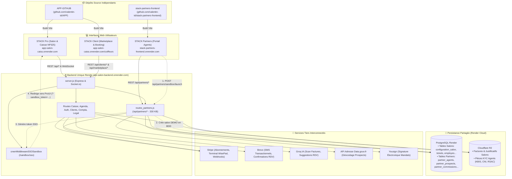

# 🌐 Écosystème Global STACK — Cartographie Multi-Repositories

> **Document de référence inter-applicatif**  
> *Dernière mise à jour : 07/11/2026*  
> *Champ d'application : Ensemble des dépôts et services de l'écosystème STACK*

---

## 1. Vue d'Ensemble & Périmètre des Repositories

L'écosystème STACK est composé de deux repositories GitHub distincts, opérant en synergie autour d'une infrastructure cloud souveraine et d'une base de données relationnelle partagée :

```
                                  ÉCOSYSTÈME STACK
                                         │
        ┌────────────────────────────────┴────────────────────────────────┐
        ▼                                                                 ▼
┌───────────────────────────────────────────┐     ┌───────────────────────────────────────────┐
│           1. REPOSITORY STACK             │     │       2. REPOSITORY STACK PARTNERS        │
│          (Logiciel & Client)              │     │                (Frontend)                 │
├───────────────────────────────────────────┤     ├───────────────────────────────────────────┤
│ • Dépôt GitHub :                          │     │ • Dépôt GitHub :                          │
│   https://github.com/valentin-td/APP.git  │     │   https://github.com/valentin-td/         │
│ • Dossier local : APP-GITHUB              │     │   stack-partners-frontend                 │
│ • Portée :                                │     │ • Dossier local : stack-partners-frontend │
│   - Backend Node.js / Express unifié      │     │ • Portée :                                │
│     (héberge /api/* ET /api/partners/*)   │     │   - SPA React 18 / Vite 5 dédiée aux      │
│   - Frontend Salon Pro (Caisse NF525,     │     │     agents commerciaux terrain            │
│     Agenda, RH, Stocks, Compta IA)        │     │   - Démarchage, prospection cartographique│
│   - Frontend Client Public (Marketplace,  │     │   - Démonstrations Sandbox en direct      │
│     Vitrine de réservation, Mon Compte)   │     │   - Onboarding & signature de mandats     │
│   - Moteur de tests automatisés           │     │   - Suivi des commissions & TPE           │
└───────────────────────────────────────────┘     └───────────────────────────────────────────┘
```

---

## 2. Diagramme Architectural Global de l'Écosystème



---

## 3. Les 4 Ponts Numériques entre Stack Client et Stack Partners

Bien que les deux interfaces frontend soient déployées séparément, elles interagissent intimement via le backend partagé :

### Pont 1 : L'Affiliation et l'Attribution Commerciale (`code_partenaire`)
1. Chaque agent inscrit sur **Stack Partners** se voit attribuer un identifiant unique (ex: `PARTNER-DUP-4821`).
2. L'agent diffuse son lien d'affiliation : `https://app-salon-caiss.onrender.com/?partner=PARTNER-DUP-4821`.
3. Lorsqu'un gérant ouvre ce lien sur **Stack Client/Pro**, le paramètre `partner` est capturé par [`PopupLegal.jsx`](file:///Users/valentinsamba/APP-GITHUB/frontend/src/PopupLegal.jsx) et persisté dans `configuration_salon.id_agent_apporteur`.
4. Lors de la souscription Stripe du salon, le webhook backend détecte l'apporteur d'affaires et génère automatiquement la commission correspondante dans `partner_commissions`.

### Pont 2 : Le Simulateur Sandbox & Démo en Direct (SSO sans Onboarding)
1. Lors d'un rendez-vous de prospection, l'agent commercial clique sur **« Lancer une Démo »** sur `stack-partners-frontend`.
2. Le frontend partenaire émet `POST /api/partners/sandbox/launch`.
3. Le backend crée un salon temporaire dans `configuration_salon` avec `est_bac_a_sable = TRUE` et peuple un jeu d'essai réaliste (planning, collaborateurs, prestations).
4. Le backend signe un JWT éphémère (`sandbox_token`) et renvoie une URL sécurisée vers **Stack Pro** : `https://app-salon-caiss.onrender.com/?sandbox_token=...`.
5. Le middleware SSO côté serveur ([`creerMiddlewareSSOSandbox`](file:///Users/valentinsamba/APP-GITHUB/services/pdf/legalAcceptancePdf.service.js)) intercepte la requête et neutralise le pop-up bloquant d'onboarding juridique pour permettre une démonstration fluide et immédiate des fonctionnalités de caisse.

### Pont 3 : La Chaîne Logistique des TPE Stripe (BBPOS WisePad™ 3)
1. Les agents disposent d'un stock physique de terminaux de paiement enregistré dans la table `partner_tpe_commandes`.
2. Lorsqu'un salon prospect est converti en client actif via le pipeline de prospection, le numéro de série du TPE (`stripe_reader_id`) est transféré directement de l'inventaire de l'agent vers la fiche du salon (`configuration_salon.stripe_reader_id`).
3. Le contrat de prêt à usage (Commodat) officiel généré côté salon intègre automatiquement ce numéro de série ainsi que les coordonnées du gérant.

### Pont 4 : Le Référentiel Légal et Fiscale Harmonisé
1. Les deux applications s'appuient sur le même référentiel contractuel et fiscal :
   - Conditions Générales d'Utilisation et de Vente (10 articles harmonisés).
   - Politique de Confidentialité RGPD (6 articles harmonisés).
   - Inviolabilité des clôtures et scellement cryptographique NF525.
2. Tout encaissement ou abonnement déclenché depuis une action partenaire respecte la traçabilité intégrale dans le Journal des Événements Techniques (`jet_logs`).

---

## 4. Matrice Comparative des Authentifications et Jetons JWT

| Critère | STACK Pro (Gérant / Employé) | STACK Client (Consommateur) | STACK Partners (Agent Commercial) |
| :--- | :--- | :--- | :--- |
| **Dépôt source** | `APP-GITHUB` | `APP-GITHUB` | `stack-partners-frontend` |
| **Clé Stockage** | `api_token` / `ui_token` | `token_client` | `partner_token` |
| **Durée de vie** | 12 heures (avec refresh) | 30 jours | 24 heures |
| **Claims JWT** | `id_salon`, `role` (`gerant`/`employe`/`salon`), `id_employe` | `id_client`, `email`, `role: 'client'` | `id_agent`, `email`, `role: 'partner'` |
| **Header HTTP** | `Authorization: Bearer <api_token>` | `Authorization: Bearer <token_client>` | `Authorization: Bearer <partner_token>` |
| **Comportement 401** | Événement `session_expiree` → Mire Pro | Événement `client_session_expiree` | Déconnexion automatique → Mire `/login` |

---

## 5. Règles de Ségrégation Git & Déploiement

1. **Isolation stricte des remotes** :
   - Toute modification du logiciel de caisse, du backend Node.js, des services, des routes partenaires ou de la documentation globale s'effectue dans `APP-GITHUB` (`origin/main`).
   - Toute modification de l'interface graphique dédiée aux agents commerciaux s'effectue dans `stack-partners-frontend` (`origin/main`).
2. **Pas de couplage de build** :
   - `APP-GITHUB/frontend` possède son propre `package.json` et build Vite.
   - `stack-partners-frontend` possède son propre `package.json` et build Vite.
3. **Synchronisation d'API** :
   - Si un endpoint dans `/api/partners` est modifié dans `APP-GITHUB/routes_partners.js`, la mise à jour correspondante dans `stack-partners-frontend/src/Dashboard.jsx` ou `Auth.jsx` doit être synchronisée et testée immédiatement.
